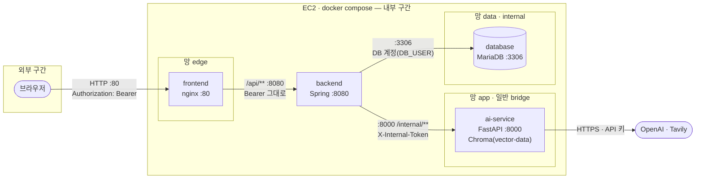
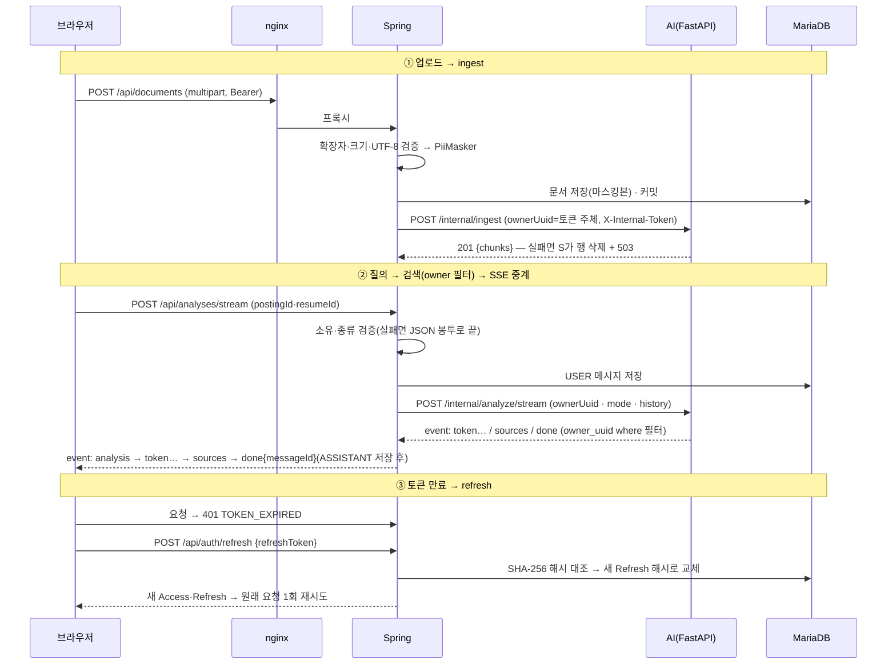

# 시스템 아키텍처 설계서

> 정본 기준 · 기준 커밋: (확정 시 기입) · v0.1 — scaffold-docs-p3 생성 2026-11-05 · 문서 오너: DevOps
> 정본: `docker-compose.yml` · `nginx/default.conf` · `SPEC.md` §1·§6 · `SecurityConfig`. 다르면 정본이 이긴다.

## 1. 시스템 개요

### 1.1 주요 컴포넌트

| 서비스 | 역할 | 이미지 | 노출 |
|---|---|---|---|
| `frontend` | nginx — React 정적 파일(SPA fallback) + `/api/` 리버스 프록시(SSE 버퍼링 끔) | `node:20.18-alpine` 빌드 → `nginx:1.27-alpine` | **외부 80 (유일한 공개 포트)** |
| `backend` | Spring Boot — 인증·인가·업로드 검증·마스킹·DB·AI 호출·SSE 중계 | `maven:3.9.9-eclipse-temurin-17` 빌드 → `eclipse-temurin:17-jre-jammy` | 내부 8080 |
| `ai-service` | FastAPI — RAG(Chroma) · LangGraph · OpenAI · Tavily · SSE | `python:3.11.10-slim` | 내부 8000 |
| `database` | MariaDB — 사용자·문서·분석·메시지 | `mariadb:10.11.10` | 내부 3306 |

볼륨: `db-data`(MariaDB) · `vector-data`(Chroma `/data/vector`).

## 2. 시스템 구성도

backend는 edge·app·data 세 망에 모두 걸린 유일한 서비스다. frontend는 DB·AI에 닿지 않고, AI는 DB에 닿지 않는다.

## 3. 기술 스택

| 구분 | 기술 | 버전 |
|------|------|------|
| Frontend | React · React Router · Zustand · Vite · Vitest · MSW | 18.3.1 · 6.30.6 · 4.5.7 · 5.4.21 · 2.1.9 · 2.15.0 |
| Backend | Spring Boot · Java · jjwt · Flyway(+flyway-mysql) · MariaDB JDBC | 3.3.5 · 17 · 0.12.6 · Boot 관리 · Boot 관리 |
| AI/ML | FastAPI · LangChain Core · LangGraph · langchain-openai · langchain-chroma · chromadb · tavily-python | 0.115.5 · 0.3.21 · 0.2.53 · 0.2.10 · 0.1.4 · 0.5.20 · 0.5.0 |
| Database | MariaDB · Chroma | 10.11.10 · 0.5.20 |

<!-- TODO(D5·DevOps): Boot 관리 버전(Flyway·MariaDB JDBC)은 `./mvnw dependency:tree` 출력에서 재발췌 -->

## 4. 컴포넌트 구조

### 4.1 Frontend

| 폴더 | 역할 |
|---|---|
| `src/api/` | `client.js`(봉투 벗기기·토큰 만료 시 refresh 1회·`streamPost`) · `sse.js`(SSE 프레임 파서) |
| `src/pages/` | 화면 5 — 로그인·가입·내 문서·분석 기록 · `analysis/`(분석 화면) |
| `src/components/` | 공용 — Button · Layout · LoadingSpinner · EmptyState · ErrorMessage |
| `src/hooks/` | `useChatStream`(스트림 읽기·누적·중단) · `useUpload` |
| `src/stores/` | Zustand — `authStore`(Access 메모리 · Refresh만 저장) · `chatStore` |
| `src/styles/` | 색·간격·브레이크포인트 토큰 한 곳 |
| `src/test/` | Vitest + MSW 공용 설정 |

### 4.2 Backend

| 패키지 (`com.jobgap`) | 역할 |
|---|---|
| `common` | 공통 응답 봉투 · ErrorCode · 전역 예외 처리 · 페이지·정렬 허용 목록 |
| `security` | SecurityConfig · JWT 발급·검증 · 401/403 핸들러 · 감사 로그 · PiiMasker |
| `auth` · `user` | 가입·로그인·Refresh 회전·로그아웃·로그인 잠금 · User 엔티티 |
| `document` | 문서 업로드·목록·수정·삭제 |
| `analysis` | 분석 스트림 중계 · 분석 목록 · 메시지 페이징 |
| `ai` | AI 내부 API 클라이언트(RestClient·WebClient) |
| `seed` | 시드 문서를 AI에 적재(프로파일 `seed`) |

### 4.3 AI Module

| 경로 | 역할 |
|---|---|
| `app/main.py` | FastAPI 라우트 — `/internal/ingest` · `/internal/analyze/stream` · `DELETE /internal/documents/{id}` · `/health` |
| `app/http.py` | 내부 토큰 검사 · 에러 봉투 · SSE 한 줄 |
| `app/vectorstore.py` | Chroma 적재·삭제·조회(owner 필터) |
| `app/graph.py` | LangGraph 분석 그래프(load → grade → [Tavily] → generate) |
| `app/providers.py` · `config.py` · `schemas.py` | LLM·임베딩 공급자 · 환경설정 · 요청 스키마 |
| `eval/` | 골든셋 세 조건 평가 |
| `tests/` | 계약 판정 테스트(키 없이 실행) |

## 5. 데이터 플로우

## 6. 보안 아키텍처

### 6.1 신뢰 경계(Trust Boundary)

| 구간 | 서비스·포트 | 공개 여부 | 경계를 넘을 때 인증 |
|---|---|---|---|
| 외부 → 내부 | `frontend` 80 (compose `ports: "80:80"`) | 외부 공개 · 보안그룹 80 전체, 22는 관리자 IP만 | `Authorization: Bearer <Access JWT>` |
| edge 망 | frontend ↔ backend 8080 | 내부 전용(포트 게시 없음) | Bearer를 그대로 전달 |
| app 망 | backend ↔ ai-service 8000 | 내부 전용 · AI의 외부 호출(OpenAI·Tavily)용 일반 bridge | `X-Internal-Token`(없으면 401) |
| data 망 | backend ↔ database 3306 | 내부 전용 · `internal: true`(외부 연결 차단) | DB 계정 `DB_USER`/`DB_PASSWORD` |

로컬 디버깅 포트는 `docker-compose.dev.yml`에서 `127.0.0.1`에만 바인드한다(외부 노출 아님).

### 6.2 인증·인가

- **인증**: JWT HS256 · subject = 사용자 uuid · Access/Refresh 만료는 `SPEC.md` §1 인증 행 · Refresh는 DB에 SHA-256 해시만 저장하고 재발급 때 교체 · 로그인 실패 잠금(SPEC §1 로그인 보호 행).
- **인가**: 컨트롤러 `@PreAuthorize("hasAnyAuthority('ROLE_USER','ROLE_ADMIN')")` + 서비스에서 리소스 소유자 검증(남의 것 403) · `/actuator/**`는 ADMIN(헬스만 공개).
- **BE↔AI**: 포트 미공개(1차) + `X-Internal-Token`(2차) · `ownerUuid`는 백엔드가 토큰 주체에서만 꺼내 보낸다 · AI는 DB에 붙지 않고 백엔드를 되부르지 않는다.

### 6.3 보안 설계 원칙 적용 내역

| 원칙 | 우리 시스템에서의 적용 |
|------|------------------------|
| Defense in Depth (다중 방어) | AI 보호 = 포트 미공개(compose) + `X-Internal-Token`(`app/http.py require_internal_token`) + owner 필터(Chroma `where`) · XSS = 텍스트 렌더 + CSP 두 겹(nginx `Content-Security-Policy` · `SecurityConfig` `contentSecurityPolicy("default-src 'none'")`) |
| Least Privilege (최소 권한) | compose 서비스별 `environment`에 필요한 키만(LLM 키는 `ai-service`에만) · backend·ai 컨테이너 비root(uid 1001) · DB는 `data` 망(`internal: true`) · `/actuator/**` ADMIN |
| Secure by Default | `management.endpoints.web.exposure.include=${ACTUATOR_EXPOSURE:health,info}` · `server.error.include-stacktrace: never` · compose 필수 변수 `${JWT_SECRET:?…}`(비면 기동 거부) · CORS Origin은 환경변수 목록(`*`이면 기동 거부 — `SecurityConfig`) |
| Never Trust Input (입력값 불신) | DTO `@Valid`(`@NotBlank`·`@Size`·`@Pattern`) · 정렬 허용 목록(`PageRequests.documentSort`) · 업로드 확장자·크기·UTF-8 검증 · 프론트가 보낸 uuid 대신 `@AuthenticationPrincipal AuthUser` · 업로드·질문 `PiiMasker`(연결 T-028) · 프롬프트에서 자료를 `<자료>` 구분자로 격리하고 자료 속 구분자 문자열은 치환(설계 — 구현 T-019·T-029 · 재현 T-036) |

### 6.4 비밀정보 관리

| 관리 대상 (키 이름 — 값 없음) | 관리 방식 |
|---|---|
| `DB_PASSWORD` · `DB_ROOT_PASSWORD` · `JWT_SECRET` · `AI_INTERNAL_TOKEN` · `OPENAI_API_KEY` · `TAVILY_API_KEY` (+ `DB_NAME` · `DB_USER` · `CORS_ALLOWED_ORIGINS` · `ACTUATOR_EXPOSURE`) | 로컬·EC2 모두 `.env`(git 제외 · `.env.example`에 키만) · EC2에서는 손으로 만들고 `chmod 600` · CI가 `.env`를 만들지 않는다 |
| GitHub Secrets | <!-- TODO(D4·DevOps): 빌드·푸시 워크플로(T-041)에서 쓰는 Secrets 이름 목록 --> |
| 커밋 검사 | `node scripts/check-sec-deploy.mjs`(현재 파일 + Git 이력) — 이력에 키가 들어가면 발급처에서 폐기·재발급 |
