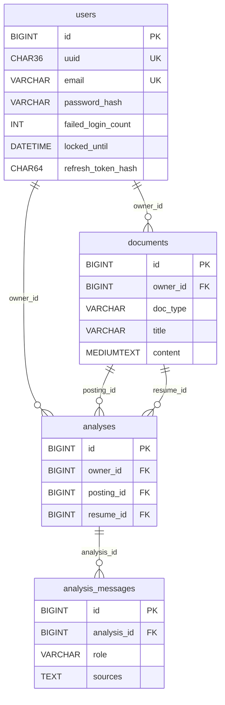

# 데이터베이스 설계서

> 정본 기준 · 기준 커밋: (확정 시 기입) · v0.1 — scaffold-docs-p3 생성 2026-11-05 · 문서 오너: BE
> 정본: `backend/src/main/resources/db/migration/V1__schema.sql`(DDL) · `SPEC.md` §2. 엔티티가 아니라 DDL이 정본이다(`ddl-auto: validate`가 기동 때 일치를 검사).

## 1. 데이터베이스 구성

- **RDBMS**: MariaDB 10.11 (스키마는 Flyway `V1__schema.sql` · 시드 `V2__seed.sql` · `utf8mb4_unicode_ci` · 시간대 +09:00)
- **Vector DB**: Chroma (ai-service 컨테이너 내장 PersistentClient · 컬렉션 1개 · named volume `vector-data`)

## 2. 주요 테이블

테이블 4개. 리프레시 토큰은 별도 테이블 대신 `users` 컬럼에 해시로 둔다(SPEC ADR-02).

### 2.1 users (사용자)

| 컬럼명 | 타입 | 제약조건 | 설명 |
|--------|------|----------|------|
| id | BIGINT | PK · AUTO_INCREMENT | 내부 식별자 |
| uuid | CHAR(36) | NOT NULL · UNIQUE(`uk_users_uuid`) | **JWT subject** — 외부에 노출되는 사용자 식별자 |
| email | VARCHAR(100) | NOT NULL · UNIQUE(`uk_users_email`) | 로그인 ID (로그에는 마스킹) |
| password_hash | VARCHAR(100) | NOT NULL | **BCrypt 해시**(60자) — 평문 저장 없음 |
| name | VARCHAR(20) | NOT NULL | 이름 |
| role | VARCHAR(10) | NOT NULL · DEFAULT 'USER' | USER / ADMIN |
| failed_login_count | INT | NOT NULL · DEFAULT 0 | **로그인 실패 횟수** — 잠금 판정 |
| locked_until | DATETIME(6) | NULL | **잠금 해제 시각** |
| refresh_token_hash | CHAR(64) | NULL | **Refresh Token SHA-256 해시** — 재발급 때 교체 · 로그아웃 때 NULL |
| refresh_expires_at | DATETIME(6) | NULL | Refresh 만료 시각 |
| created_at | DATETIME(6) | NOT NULL | 가입 시각 |

### 2.2 documents (문서)

| 컬럼명 | 타입 | 제약조건 | 설명 |
|--------|------|----------|------|
| id | BIGINT | PK · AUTO_INCREMENT | |
| owner_id | BIGINT | NOT NULL · FK → users.id | **소유자** — 모든 조회·수정·삭제의 소유 검증 기준 |
| doc_type | VARCHAR(20) | NOT NULL | JOB_POSTING / RESUME |
| title | VARCHAR(100) | NOT NULL · UNIQUE(owner_id, title) | 문서 제목(마스킹 후) |
| content | MEDIUMTEXT | NOT NULL | **마스킹된 본문만** — 원본 파일은 저장하지 않는다 |
| char_count | INT | NOT NULL | 글자 수 |
| masked_count | INT | NOT NULL · DEFAULT 0 | 가린 개인정보 개수 |
| created_at | DATETIME(6) | NOT NULL · INDEX(owner_id, created_at) | 업로드 시각 |

### 2.3 analyses (분석 — 대화 1건)

| 컬럼명 | 타입 | 제약조건 | 설명 |
|--------|------|----------|------|
| id | BIGINT | PK · AUTO_INCREMENT | |
| owner_id | BIGINT | NOT NULL · FK → users.id | **소유자** |
| posting_id | BIGINT | NOT NULL · FK → documents.id | 분석한 채용공고 |
| resume_id | BIGINT | NOT NULL · FK → documents.id | 분석한 이력서 |
| title | VARCHAR(100) | NOT NULL | 공고 제목 + " × " + 이력서 제목(100자 절단) |
| created_at | DATETIME(6) | NOT NULL · INDEX(owner_id, created_at) | |

### 2.4 analysis_messages (분석 메시지)

| 컬럼명 | 타입 | 제약조건 | 설명 |
|--------|------|----------|------|
| id | BIGINT | PK · AUTO_INCREMENT | |
| analysis_id | BIGINT | NOT NULL · FK → analyses.id · INDEX(analysis_id, id) | 소속 분석 |
| role | VARCHAR(10) | NOT NULL | USER / ASSISTANT — ASSISTANT는 스트림이 끝까지 완주했을 때만 저장 |
| content | MEDIUMTEXT | NOT NULL | 질문(마스킹 후) 또는 리포트·답변 |
| sources | TEXT | NOT NULL | 출처 JSON 배열 문자열(문서 조각·웹) · USER는 `[]` |
| created_at | DATETIME(6) | NOT NULL | |

<!-- 리프레시 토큰 테이블 없음 — users.refresh_token_hash·refresh_expires_at 컬럼 (SPEC ADR-02 · 2.1 표에 설명) -->

## 3. 관계

| FK | 다중성 | JPA 방향 | Fetch | Cascade |
|---|---|---|---|---|
| documents.owner_id → users.id | User 1 : N Document | 단방향(Document → User) | LAZY | 없음 |
| analyses.owner_id → users.id | User 1 : N Analysis | 단방향 | LAZY | 없음 |
| analyses.posting_id → documents.id | Document 1 : N Analysis | 단방향 | LAZY | 없음 |
| analyses.resume_id → documents.id | Document 1 : N Analysis | 단방향 | LAZY | 없음 |
| analysis_messages.analysis_id → analyses.id | Analysis 1 : N AnalysisMessage | **양방향**(`Analysis.messages` · `mappedBy`) — 대화 화면이 메시지를 순서대로 읽고 생명주기가 같다 | LAZY | `ALL` + `orphanRemoval` (이 관계만) |

DB 쪽 FK는 전부 RESTRICT(DB cascade 없음). 문서 삭제 순서는 코드가 보장한다: AI 청크 삭제 → 그 문서를 쓴 분석(메시지는 orphanRemoval) → 문서.

## 4. 벡터 DB 설정

엔진 Chroma(단일 컬렉션 `jobgap`) · 임베딩 OpenAI `text-embedding-3-small`(바꾸면 인덱스 재생성) · 분할 `RecursiveCharacterTextSplitter` ·
메타데이터 `owner_uuid` · `document_id` · `doc_type` · `seq`(청크 순번) · **사용자 격리 = 검색·조회·삭제 전부 `where`에 `owner_uuid`** ·
저장 위치 `/data/vector`(named volume `vector-data` — 컨테이너를 다시 만들어도 유지).

- **벡터 차원**: <!-- TODO(D3·AI): `len(get_embeddings().embed_query("x"))` 실측 출력을 그대로 -->
- **청크 크기**: 500자
- **오버랩**: 50자
